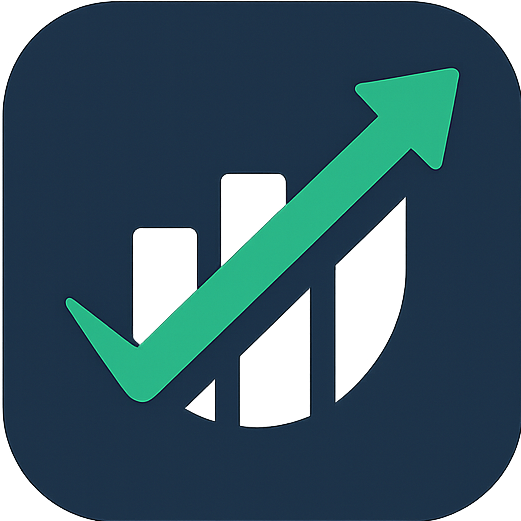

<div align="center">

  

  # 💸 FinTrack
  ### *Master Your Wealth • Elevate Your Lifestyle*

  <p align="center">
    <b>Ứng dụng quản lý tài chính cá nhân thế hệ mới</b> — Kết hợp giữa tư duy thiết kế <b>Minimalist Luxury</b>, hiệu năng cực đỉnh với kiến trúc <b>Offline-First</b> và nền tảng <b>Clean Architecture</b> chuẩn mực.
  </p>

  <p align="center">
    <a href="https://flutter.dev"></a>
    <a href="https://dart.dev"></a>
    <a href="https://firebase.google.com"></a>
    <a href="https://pub.dev/packages/hive"></a>
    <a href="#"></a>
    <a href="#"></a>
  </p>

  <p align="center">
    <a href="#-tổng-quan">Tổng Quan</a> •
    <a href="#-tính-năng-nổi-bật">Tính Năng</a> •
    <a href="#-triết-lý-thiết-kế--uiux">Thiết Kế</a> •
    <a href="#-kiến-trúc-hệ-thống">Kiến Trúc</a> •
    <a href="#-ngăn-xếp-công-nghệ">Công Nghệ</a> •
    <a href="#-cấu-trúc-thư-mục">Cấu Trúc</a> •
    <a href="#-hướng-dẫn-cài-đặt">Cài Đặt</a> •
    <a href="#-lộ-trình-phát-triển">Roadmap</a>
  </p>

</div>

---

## 🌟 Tổng Quan

Trong thời đại số hóa, việc kiểm soát dòng tiền cá nhân không chỉ dừng lại ở các con số khô khan mà là trải nghiệm sống có kế hoạch và tự chủ. **FinTrack** ra đời nhằm mang đến giải pháp quản trị tài chính cá nhân toàn diện:

- **Tốc độ phản hồi tức thì (<16ms)** nhờ công nghệ cơ sở dữ liệu nhúng **Hive NoSQL**, hoạt động trơn tru 100% ngay cả khi **không có kết nối mạng (Offline-First)**.
- **Trải nghiệm thị giác cao cấp**: Sử dụng bảng màu xanh Ngọc Lục Bảo mint hiện đại (`#00D09E`), đường nét bo cong mềm mại và chuyển động mượt mà.
- **Trợ lý quản lý hạn mức thông minh**: Phân tích và đưa ra lời khuyên tài chính theo thời gian thực dựa trên tiến độ ngân sách hằng ngày.

---

## ✨ Tính Năng Nổi Bật

### 1. 📊 Bảng Điều Khiển Thông Minh (Smart Financial Dashboard)
- **Tổng quan dòng tiền**: Hiển thị tức thì **Tổng số dư (Total Balance)** và **Tổng chi tiêu (Total Expense)** với định dạng tiền tệ chuyên nghiệp.
- **Thẻ tóm tắt biến động ngày (Daily Snapshot Card)**: Phân tách rõ ràng dòng thu (*Income*) và dòng chi (*Expense*) trong ngày hiện tại, tính toán ròng (*Net*) chính xác.
- **Chào hỏi cá nhân hóa**: Đồng bộ hóa theo tên hiển thị và phiên đăng nhập của người dùng.

### 2. 🎯 Quản Lý Hạn Mức Hằng Ngày & Cảnh Báo Thông Minh (Smart Budgeting & Dynamic Feedback)
- **Thiết lập mục tiêu chi tiêu**: Tùy chỉnh ngân sách chi tiêu tối đa mỗi ngày với dialog nhập liệu tiện lợi.
- **Thanh tiến độ chi tiêu thích ứng (Adaptive Expense Progress Bar)**: Động thái hiển thị phần trăm đã chi cùng hiệu ứng hoạt họa mượt mà.
- **Thuật toán phản hồi sức khỏe tài chính**:
  - `≤ 30%`: 🟢 Chi tiêu rất ổn định, an toàn.
  - `31% - 50%`: 🟡 Nên chú ý quan sát tốc độ chi.
  - `51% - 80%`: 🟠 Cân nhắc làm chậm tốc độ tiêu dùng.
  - `81% - 99%`: 🔴 Cảnh báo sắp chạm trần hạn mức!
  - `≥ 100%`: 🚨 Báo động đỏ — Vượt quá ngân sách cho phép!

### 3. 📈 Biểu Đồ Trực Quan Đa Chiều (Advanced Analytics with FL Chart)
- **Chuyển đổi góc nhìn linh hoạt (Cupertino Segmented Control)**:
  - **Ngày (Daily Layout)**: Xem biểu đồ phân bổ thu/chi từng ngày trong tuần.
  - **Tuần (Weekly Layout)**: So sánh biến động giữa các tuần.
  - **Tháng (Monthly Layout)**: Bức tranh toàn cảnh tài chính 12 tháng trong năm.
- **Bộ chọn mốc thời gian (Date Picker Integrated)**: Chủ động tra cứu dữ liệu lịch sử tài chính ở bất kỳ mốc thời gian nào.

### 4. 🏷️ Hệ Thống Danh Mục Chi Tiêu Động (Dynamic Category Management)
- **Thư viện danh mục phong phú**: Phân loại sẵn các nhóm tiêu dùng thiết yếu (Ăn uống, Giải trí, Mua sắm, Du lịch,...).
- **Tùy biến không giới hạn**: Cho phép tạo danh mục mới với **Bộ chọn biểu tượng Material Icons trực quan (Icon Picker)**.
- **Quản lý danh mục chuyên sâu (Category Detail)**: Lọc và xem danh sách các giao dịch thuộc riêng từng danh mục.
- **Cơ chế xóa an toàn**: Cảnh báo xác nhận xóa danh mục kèm theo việc dọn dẹp các giao dịch phụ thuộc (Cascade Delete Prevention).

### 5. 💳 Ghi Nhận Giao Dịch Nhanh Chóng (Seamless Transaction Flow)
- **Input định dạng thông minh**: Bộ lọc `CurrencyInputFormatter` tự động phân tách hàng nghìn (`100.000 ₫`) khi nhập liệu.
- **Đầy đủ trường thông tin**: Tiêu đề, Số tiền, Danh mục, Ngày phát sinh, Ghi chú chi tiết, Phân loại Thu/Chi.
- **Thao tác nhanh gọn**: Chỉnh sửa (*Edit*) hoặc xóa (*Delete*) giao dịch nhanh chóng với phản hồi Snackbar tức thì.

### 6. 🔐 Bảo Mật & Xác Thực Người Dùng (Firebase Authentication)
- **Đăng ký & Đăng nhập chuẩn xác**: Kiểm tra định dạng Regex email, độ dài mật khẩu và ràng buộc ký tự username chặt chẽ.
- **Quản lý tài khoản**: Thay đổi mật khẩu mới, cập nhật tên người dùng (Username), Đăng xuất an toàn.
- **Khôi phục mật khẩu**: Gửi email reset password tiện lợi qua dịch vụ Firebase.

### 7. 🌐 Bản Địa Hóa Song Ngữ Hoàn Chỉnh (Internationalization - i18n)
- Hỗ trợ đầy đủ **Tiếng Việt 🇻🇳** và **Tiếng Anh 🇬🇧**.
- Chuyển đổi ngôn ngữ tức thì trong phần Cài đặt và tự động ghi nhớ tùy chọn vào `SharedPreferences`.

---

## 🎨 Triết Lý Thiết Kế & UI/UX

FinTrack được thiết kế với ngôn ngữ thị giác hiện đại, mang hơi thở của phong cách **FinTech Đương Đại**:

| Thành Phần | Giá Trị Mã Màu | Ứng Dụng |
| :--- | :--- | :--- |
| **Emerald Primary** | `#00D09E` | Nền Header, Nút hành động chính, Icon active, Điểm nhấn thương hiệu |
| **Soft Mint Surface** | `#F1FFF3` | Nền khu vực nội dung chính, thẻ card phân cấp |
| **Light Mint Accent** | `#DFF7E2` | Bottom Navigation Bar, Segmented Control Container |
| **Deep Ocean Blue** | `#00416A` | Gradient nút hành động, tạo chiều sâu thị giác |
| **Pure White** | `#FFFFFF` | Nền hộp thoại, thẻ giao dịch nổi bật |

### Điểm nhấn trải nghiệm:
- **Ergonomic Curves**: Các góc bo tròn lớn (`24px`, `32px`, `40px`) tạo cảm giác mềm mại, thân thiện khi cầm nắm và vuốt chạm.
- **Floating Floating Navigation**: Thanh điều hướng nổi với hiệu ứng bóng mờ nhẹ, tối ưu không gian màn hình.
- **Responsive Feedback**: Mọi tương tác chạm, lưu, cập nhật đều có phản hồi trực quan bằng hoạt ảnh và SnackBar.

---

## 🏗️ Kiến Trúc Hệ Thống (Clean Architecture)

Dự án tuân thủ nghiêm ngặt nguyên lý **Clean Architecture** kết hợp mô hình **MVVM** (Model - View - ViewModel) thông qua `Provider`:

```mermaid
flowchart TD
    subgraph Presentation_Layer["📱 Presentation Layer (UI & State)"]
        UI["Screens & Widgets<br/>(Dashboard, Category, Settings, Forms)"]
        VM["ViewModels (ChangeNotifier)<br/>(TransactionViewModel, AuthViewModel, CategoryViewModel)"]
        UI <--> VM
    end

    subgraph Domain_Layer["🧠 Domain Layer (Core Business Rules)"]
        UC["Use Cases<br/>(AddTransaction, GetDailyBudget, SignIn, ...)"]
        E["Entities<br/>(Transaction, DailyBudget, DailySummary, Category, User)"]
        IR["Repository Interfaces<br/>(TransactionRepository, UserRepository, CategoryRepository)"]
        VM --> UC
        UC --> E
        UC --> IR
    end

    subgraph Data_Layer["💾 Data Layer (Data Sources & Infrastructure)"]
        RI["Repository Implementations<br/>(TransactionRepositoryImpl, ...)"]
        DS_Local["Local Storage<br/>(Hive DB: Boxes, TypeAdapters)"]
        DS_Remote["Remote Services<br/>(Firebase Auth, Firestore)"]
        IR <|.. RI
        RI --> DS_Local
        RI --> DS_Remote
    end
```

---

## 💻 Ngăn Xếp Công Nghệ (Tech Stack)

| Hạng mục | Công nghệ / Thư viện | Mục đích sử dụng |
| :--- | :--- | :--- |
| **Core Framework** | `Flutter SDK ^3.9.0` / `Dart` | Nền tảng phát triển ứng dụng đa nền tảng |
| **State Management** | `provider: ^6.0.5` | Quản lý trạng thái phân tầng, phản ứng nhanh và tinh gọn |
| **Local Database** | `hive: ^2.2.3` & `hive_flutter: ^1.1.0` | CSDL NoSQL nhúng siêu tốc cho kiến trúc Offline-First |
| **Code Generation** | `build_runner` & `hive_generator` | Tự động sinh `TypeAdapter` cho các thực thể lưu trữ |
| **Data Visualization** | `fl_chart: ^0.69.0` | Vẽ biểu đồ cột thu/chi linh hoạt và có độ tương tác cao |
| **Authentication** | `firebase_auth: ^5.3.1` | Quản lý đăng ký, đăng nhập và bảo mật phiên người dùng |
| **Cloud Service** | `cloud_firestore: ^5.4.4` | Chuẩn bị sẵn sàng cho tính năng đồng bộ đám mây |
| **Localization** | `flutter_localizations` & `intl` | Định dạng tiền tệ, ngày tháng và đa ngôn ngữ (vi / en) |
| **Persistent KV** | `shared_preferences: ^2.2.3` | Lưu cấu hình người dùng (ngôn ngữ, tùy biến) |
| **Splash Screen** | `flutter_native_splash: ^2.3.2` | Tối ưu trải nghiệm khởi động ứng dụng mượt mà |

---

## 📁 Cấu Trúc Thư Mục (Project Structure)

```text
fin_track/
├── 📂 assets/                     # Tài nguyên tĩnh của ứng dụng
│   ├── 📂 icon/                   # App icon & Launcher assets
│   └── 📂 images/                 # Minh họa, logo đối tác (Google, Facebook, Avatar)
├── 📂 lib/
│   ├── 📂 components/             # Reusable formatters & helper components
│   │   └── currenct_input_formatter.dart
│   ├── 📂 core/                   # Cấu hình cốt lõi, Dependency Injection
│   ├── 📂 features/               # Kiến trúc Feature-Driven
│   │   ├── 📂 auth/               # Module Xác thực (Data, Domain, Presentation)
│   │   ├── 📂 category/           # Module Quản lý Danh mục (Hive Box, Grid, Picker)
│   │   ├── 📂 dashboard/          # Module Màn hình chính, Thanh tiến độ & Biểu đồ
│   │   │   ├── 📂 ui/
│   │   │   │   └── 📂 chart/      # Các layout biểu đồ Ngày/Tuần/Tháng với FL Chart
│   │   ├── 📂 main/               # Shell navigation & BottomNavigationBar
│   │   ├── 📂 settings/           # Cài đặt ứng dụng, hồ sơ, đổi mật khẩu, ngôn ngữ
│   │   └── 📂 transaction/        # Module Giao dịch & Ngân sách hằng ngày
│   ├── 📂 l10n/                   # File định nghĩa đa ngôn ngữ (.arb & gen files)
│   │   ├── app_en.arb             # Tiếng Anh
│   │   └── app_vi.arb             # Tiếng Việt
│   ├── firebase_options.dart      # Cấu hình Firebase đa nền tảng
│   └── main.dart                  # Khởi tạo Services, DI, Providers & Entry Point
├── 📄 firebase.json               # Cấu hình Firebase CLI
├── 📄 pubspec.yaml                # Khai báo packages & dependencies
└── 📄 README.md                   # Tài liệu dự án
```

---

## 🚀 Hướng Dẫn Cài Đặt & Khởi Chạy

### Yêu Cầu Môi Trường (Prerequisites)
- [Flutter SDK](https://docs.flutter.dev/get-started/install) (Khuyến nghị bản `>= 3.24.0` hoặc mới nhất).
- [Dart SDK](https://dart.dev/get-dart) bản `>= 3.0.0`.
- [Android Studio](https://developer.android.com/studio) hoặc [VS Code](https://code.visualstudio.com/) với Flutter extension.
- Thiết bị thật hoặc máy ảo (Android Emulator / iOS Simulator).

### Các Bước Cài Đặt (Step-by-Step)

1. **Clone repository về máy local:**
   ```bash
   git clone https://github.com/your-username/fin_track.git
   cd fin_track
   ```

2. **Cài đặt các thư viện phụ thuộc:**
   ```bash
   flutter pub get
   ```

3. **Sinh mã tự động cho Hive TypeAdapters:**
   ```bash
   dart run build_runner build --delete-conflicting-outputs
   ```

4. **Sinh mã cho hệ thống Đa ngôn ngữ (L10n):**
   ```bash
   flutter gen-l10n
   ```

5. **Cấu hình Firebase:**
   - Dự án đã tích hợp sẵn tệp cấu hình qua `flutterfire configure`.
   - Nếu bạn muốn dùng Firebase Project của riêng mình, chạy:
     ```bash
     flutterfire configure
     ```

6. **Khởi chạy ứng dụng:**
   ```bash
   flutter run
   ```

---

## 🗺️ Lộ Trình Phát Triển (Roadmap)

- [x] Kiến trúc Clean Architecture phân tầng hoàn chỉnh.
- [x] Lưu trữ cục bộ siêu tốc với Hive NoSQL (Offline-First).
- [x] Biểu đồ phân tích tài chính FL Chart (Ngày / Tuần / Tháng).
- [x] Bản địa hóa song ngữ Tiếng Việt 🇻🇳 & Tiếng Anh 🇬🇧.
- [ ] 🔄 **Cloud Sync 2 chiều**: Tự động đồng bộ Hive DB lên Cloud Firestore khi có kết nối mạng.
- [ ] 🛡️ **Bảo mật sinh trắc học**: Xác thực mở khóa ứng dụng bằng Face ID / Vân tay.
- [ ] 📄 **Báo cáo tài chính**: Xuất dữ liệu giao dịch ra tệp Excel (.xlsx) và PDF.
- [ ] 🤖 **Smart AI Financial Advisor**: Ứng dụng Gemini AI để phân tích thói quen tiêu dùng và đưa ra kế hoạch tiết kiệm thông minh.
- [ ] 🔔 **Nhắc nhở thông minh**: Nhắc nhập giao dịch vào cuối ngày qua Local Notifications.

---

## 👥 Đóng Góp & Tác Quyền

Dự án được xây dựng với tâm huyết nhằm mang lại một sản phẩm Flutter chỉn chu, mẫu mực về mặt cấu trúc code và trải nghiệm người dùng.

Mọi ý kiến đóng góp, mở Issue hoặc Pull Request đều được hoan nghênh nồng nhiệt!

---

<div align="center">
  <sub>Được thiết kế và phát triển với ❤️ dành cho cộng đồng Flutter developers.</sub>
  <br />
  <b>© 2026 FinTrack. All rights reserved.</b>
</div>
